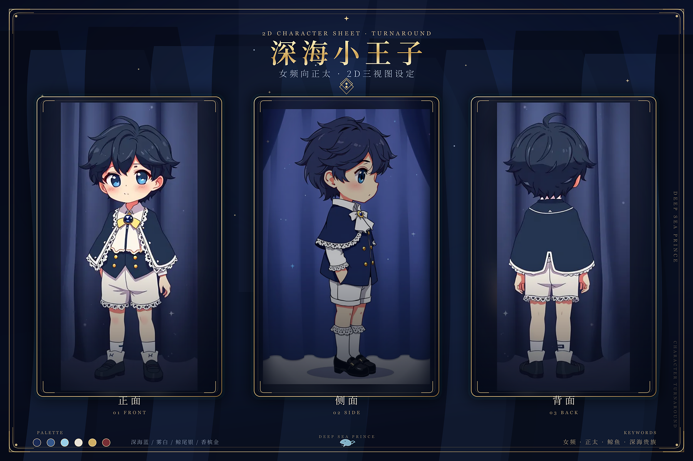

# dsh-pet-prince

> 深海小王子 —— 住在 DeepSeek Harness Web UI 里的 2D 透明立绘桌宠。
> A 2D transparent-sprite desktop pet for the DeepSeek Harness Web UI.




## 功能

- **高清精灵表动画**：`3072 × 3744`、8 列 × 9 行、单元格 `384 × 416`，透明背景
- **无背景人物**：透明立绘，不再使用卡片底和帷幕背景
- **9 个状态**：`idle` / `running-right` / `running-left` / `waving` / `jumping` / `failed` / `waiting` / `running` / `review`
- **点击互动**：单击挥手，双击跳跃
- **拖拽**：按住角色拖动到任意位置，位置保存在本地
- **右键菜单**：挥手 / 跳跃 / 等待 / 隐藏 / 复位位置
- **设置页**：显示开关、大小、贴边角落、水平/垂直边距，保存即生效
- **零后端依赖**：宿主半侧只负责提供素材与保存外观配置；动画与交互全部在浏览器端
- **可换肤**：素材在 `assets/spritesheet.webp`，替换后即可变成自己的角色

## 安装

### 方式一：本地目录安装（当前可用，推荐）

在仓库目录运行：

```bash
node scripts/install-local.mjs
```

脚本会复制到 `~/.dsh/profiles/desktop/node_modules/dsh-pet-prince`，并自动把 `dsh-pet-prince` 加进 `dsh.profile.bundles`（原 `package.json` 备份为 `.bak`）。然后重启 Harness。

也可以手动操作：

1. 把本目录复制到 DSH profile 的 `node_modules`：
   ```text
   ~/.dsh/profiles/desktop/node_modules/dsh-pet-prince
   ```
2. 在 `~/.dsh/profiles/desktop/package.json` 的 `dsh.profile.bundles` 中加入：
   ```json
   "dsh-pet-prince"
   ```
3. 重载 DSH / 重启 Harness。
4. 打开「设置 → 插件配置」，应能看到「深海小王子」；桌面右下角出现桌宠。

### 方式二：发布到 npm / 插件市场后

在 DSH 的「设置 → 插件 → 安装插件」中搜索 / 输入 `dsh-pet-prince`，安装后重启或重载插件。

> 插件是标准的 DSH bundle：`dsh.bundle.patch` 指向 `cordis.patch.yml`，`dsh.client` 声明浏览器半侧，`exports["./client"]` 提供 `/plugins/dsh-pet-prince/client.js`。

## 使用

| 操作 | 效果 |
|---|---|
| 单击 | 挥手 |
| 双击 | 跳跃 |
| 拖拽 | 移动，松开后保存位置 |
| 右键 | 动作菜单 |
| 设置页 | 开关 / 大小 / 角落 / 边距 |

配置文件：`~/.dsh/dsh-pet-prince/config.json`

```json
{
  "enabled": true,
  "scale": 1,
  "corner": "bottom-right",
  "marginX": 24,
  "marginY": 16
}
```

## 精灵表规格

| 属性 | 值 |
|---|---|
| 尺寸 | `3072 × 3744` |
| 网格 | 8 列 × 9 行 |
| 单元格 | `384 × 416` |
| 背景 | 透明 |
| 未使用格 | 全透明 |
| 格式 | 无损 WebP（也提供 PNG） |

行顺序：

| 行 | 状态 | 帧数 |
|---|---|---|
| 0 | idle | 6 |
| 1 | running-right | 8 |
| 2 | running-left | 8 |
| 3 | waving | 4 |
| 4 | jumping | 5 |
| 5 | failed | 8 |
| 6 | waiting | 6 |
| 7 | running | 6 |
| 8 | review | 6 |

## 开发

```bash
node --check index.js
node --check client.js
node test-host.mjs
```

`test-host.mjs` 用假的 `ctx.webServer` 验证路由、配置读写和素材响应，不依赖 DSH 进程。

### 目录

```text
dsh-pet-prince/
├── index.js            # 宿主半侧：路由 + 配置持久化
├── client.js           # 浏览器半侧：overlay + 设置页
├── cordis.patch.yml    # DSH bundle 挂载声明
├── package.json
├── assets/
│   ├── pet.json
│   ├── spritesheet.webp
│   ├── preview.gif
│   └── logo.png
├── docs/
│   ├── preview.gif
│   ├── spritesheet.webp
│   └── threeview.png
└── test-host.mjs
```

## 当前范围

v0.1 是 **Web overlay** 版本：宠物显示在 DSH 网页里，支持动画、点击、拖拽、右键菜单和设置。

尚未包含 dsh-pet 的以下能力：Electron 透明置顶桌面窗、余额动画、AI 碎碎念/对话、系统通知、多宠物同屏。这些都可以作为后续版本继续扩展。

## 素材与许可

- 角色立绘：本项目原创 2D 素材，见 `docs/threeview.png`
- 代码：MIT
- 角色设定：深海小王子 / 女频向正太 / 鲸鱼主题

## GitHub

仓库：<https://github.com/qian3194323719-a11y/dsh-pet-prince>

本目录已经按「可直接发布」的仓库结构整理好。没有 git 二进制也可以发布：

```bash
GITHUB_TOKEN=github_pat_xxx node scripts/publish-github.mjs
```

脚本会：

1. 用 token 查当前 GitHub 用户；
2. 不存在 `dsh-pet-prince` 仓库时自动创建公开仓库；
3. 用 Git Data API 写入全部文件并创建 `feat: dsh-pet-prince 0.1.0` 提交；
4. 输出仓库地址。

Token 只需要 `repo` 权限（fine-grained：Contents + Administration）。发布后把 `package.json` 的 `homepage` / `repository` 换成实际地址即可。


## License

MIT © 2026 dsh-pet-prince contributors
